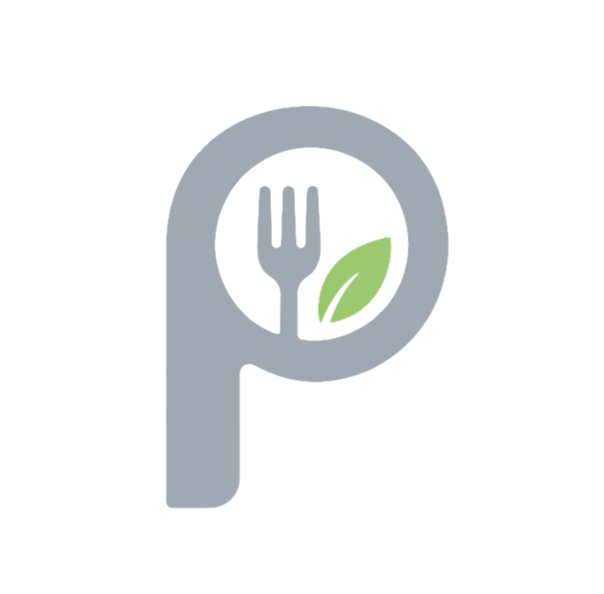
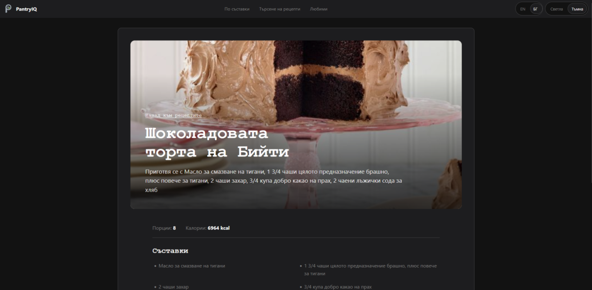
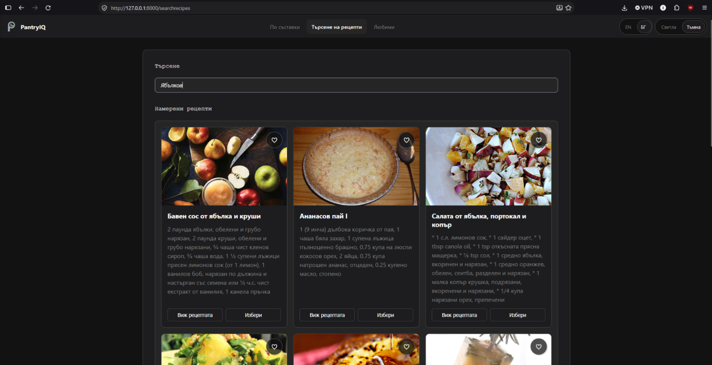
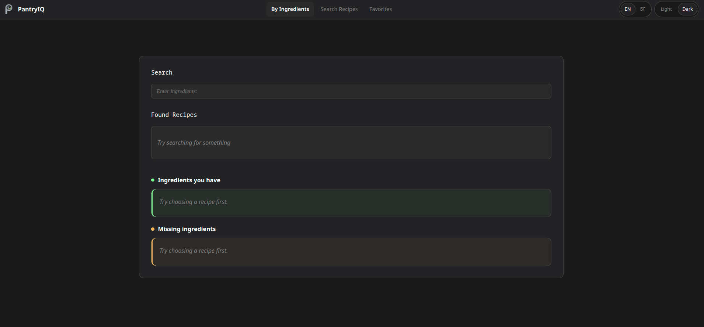
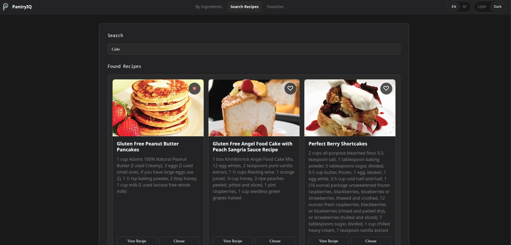
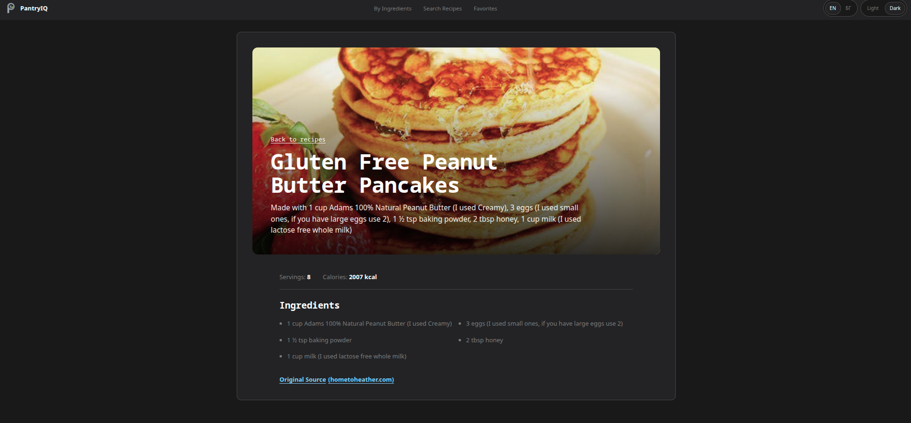

# PantryIQ

PantryIQ is a local web application that helps you find recipes by name or by the ingredients you already have. It includes recipe details, saved favorites, paginated results, dark and light themes, and English/Bulgarian translation.



## Features

- Search the recipe dataset by recipe name
- Search by comma-separated ingredients
- Compare an ingredient list with a chosen recipe
- View recipe ingredients, servings, calories, and the original source
- Save and remove favorite recipes in browser local storage
- Switch between English and Bulgarian
- Switch between light and dark themes

## Screenshots











## Requirements

- Python 3
- `pip`
- `curl` on Linux
- `unzip` on Linux
- A C++ compiler and Python development headers
- Internet access only for downloading the LibreTranslate language models

LibreTranslate is optional for browsing and searching recipes. It is required to translate recipe information and interface search text between English and Bulgarian.

## Dataset extraction

The downloaded repository includes `assets/dataset/full_dataset.zip`, but the application expects the extracted CSV file at `assets/dataset/full_dataset.csv`. Extract the archive before starting PantryIQ.

On Windows:

```powershell
Expand-Archive -Path .\assets\dataset\full_dataset.zip -DestinationPath .\assets\dataset -Force
```

On Linux:

```bash
unzip assets/dataset/full_dataset.zip -d assets/dataset
```

Confirm that `assets/dataset/full_dataset.csv` exists. The existing `full_dataset.zip` can be kept after extraction.

## Quick start

### Windows

LibreTranslate may need native Python packages to compile during installation. Install **Microsoft C++ Build Tools** (the **Desktop development with C++** workload) first.

Open PowerShell in the project directory and run:

```powershell
python -m venv .venv
.\.venv\Scripts\Activate.ps1
python -m pip install --upgrade pip
python -m pip install pandas flask libretranslate
```

Download and install the English/Bulgarian models, then start LibreTranslate:

```powershell
.\install-libretranslate-models.ps1
.\start-libretranslate.ps1
```

The PowerShell scripts use `python` and `libretranslate` from the active virtual environment. The LibreTranslate start script opens a hidden process and keeps it running while PantryIQ is in use.

Start PantryIQ in the same activated virtual environment:

```powershell
python app.py
```

Open <http://127.0.0.1:8000>.

LibreTranslate logs on Windows are stored in `%LOCALAPPDATA%\PantryIQ\LibreTranslate`.

### Linux

LibreTranslate may need native Python packages to compile during installation. Install a C++ compiler and the Python development headers before installing LibreTranslate. On Fedora:

Fedora example:

```bash
sudo dnf install python3 python3-pip python3-devel gcc gcc-c++ curl unzip
cd /path/to/PantryIQ
unzip assets/dataset/full_dataset.zip -d assets/dataset
python3 -m venv .venv
.venv/bin/python -m pip install --upgrade pip
.venv/bin/python -m pip install pandas flask libretranslate
chmod +x install-libretranslate-models.sh start-libretranslate.sh
./install-libretranslate-models.sh
./start-libretranslate.sh
./.venv/bin/python app.py
```

Open <http://127.0.0.1:8000>.

The start script launches LibreTranslate in the background at `127.0.0.1:5000`. Logs and the PID file are stored in `$XDG_STATE_HOME/pantryiq/libretranslate/`, or `$HOME/.local/state/pantryiq/libretranslate/` when `XDG_STATE_HOME` is unset.

Both shell scripts accept an explicitly selected Python interpreter:

```bash
PYTHON=/path/to/python ./install-libretranslate-models.sh
PYTHON=/path/to/python ./start-libretranslate.sh
```

## Running without translation

PantryIQ can start without LibreTranslate:

```bash
.venv/bin/python -m pip install pandas flask
.venv/bin/python app.py
```

On Windows, activate the environment and run `python app.py`. Recipe search and favorites remain available, but selecting Bulgarian may leave untranslated text or show a translation error for text that needs localization.

## Configuration

PantryIQ loads optional settings from a `.env` file in the project root. It supports `LIBRETRANSLATE_URL` and `LIBRETRANSLATE_API_KEY`.

```dotenv
LIBRETRANSLATE_URL=http://127.0.0.1:5000
# LIBRETRANSLATE_API_KEY=your-api-key
```

The local translation scripts do not require an API key. Generated translations are cached in `assets/dataset/translation_cache.sqlite3`.

## Dataset

The application reads `assets/dataset/full_dataset.csv` at startup. The original compressed copy is included as `assets/dataset/full_dataset.zip`.

The dataset, generated translation cache, and downloaded LibreTranslate models are ignored by Git. The dataset and LibreTranslate model directories must remain in place for the relevant features to work.

## Project structure

```text
app.py                         Flask server, recipe APIs, and translation API
html/                          Page templates
css/                           Light and dark styles
js/                            Browser-side search, favorites, language, and theme logic
assets/dataset/                Recipe CSV and translation cache
assets/logo/                   PantryIQ icons and logo assets
assets/screenshots/           README and project screenshots
install-libretranslate-*       Download English/Bulgarian Argos models
start-libretranslate-*         Start the local LibreTranslate service
```

## License

See the repository for licensing information.
